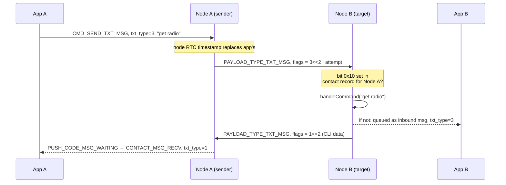

# The Companion CLI

Every infrastructure MeshCore role — Repeater, Room Server, Sensor — answers to
a text command line. Companion Radio firmware did not: apart from a USB
"rescue" console reachable through the device UI, a companion node could only
be configured by the app that was attached to it. **New in v1.18.0**, companion
nodes have a general-purpose command line: they can execute the same kind of
`get radio` / `set tx` / `reboot` commands you would type at a repeater, either
from the attached app or from another node over the mesh.

This page explains both entry paths, how the firmware registers commands, and
why the permission that enables the mesh path deserves the same care as an
admin password.

## Two ways in, one handler

The companion CLI is text in, text out. What differs between the two paths is
who sends the text and where it travels:

| Path | Wire form | Who initiates | Authorisation |
|---|---|---|---|
| **Local** | `CMD_RUN_CLI_COMMAND` (`66`) on the app transport | the attached app | possessing the transport (BLE pairing, serial port, TCP reachability) |
| **Remote** | `TXT_TYPE_CLI_COMMAND` (`3`) inside a `PAYLOAD_TYPE_TXT_MSG` | a peer node on the mesh | the **Remote CLI** flag in the receiving node's contact record for the sender |

Both paths funnel into the same `MyMesh::handleCommand()` in
`examples/companion_radio`, so a command that works locally works remotely, and
vice versa. So does the USB-serial "CLI rescue" console — the same handler,
called with `sender_timestamp = 0`.

The companion firmware's built-in command set is deliberately small, because
companion nodes are configured mostly by the app. It covers radio and airtime
settings, node name, BLE PIN, time zone, `ver`/`board`, reboot/power-off, and
the Wi-Fi settings on builds that have a Wi-Fi interface. Anything beyond that
is added by the board variant — see
[Registering commands for custom firmware](#registering-commands-for-custom-firmware).

!!! note "Companion CLI ≠ Remote Admin CLI"
    The [Remote Admin CLI](../operating/remote-admin-cli.md) is the *repeater /
    room server / sensor* CLI, reached by logging in with an admin password.
    The companion CLI is a different code path with a much smaller command set
    and, on the remote side, **no password at all** — see
    [The Remote CLI permission](#the-remote-cli-permission).

## The local path: `CMD_RUN_CLI_COMMAND`

New in v1.18.0, command byte `66` (`0x42`). The payload is simply the command
text — everything after the command byte:

```
App  → [66][command text …]                 CMD_RUN_CLI_COMMAND
Node → [29][reply text …]                   RESP_CODE_CLI_REPLY
```

The matching response code is `RESP_CODE_CLI_REPLY` (`29`, `0x1D`), also new in
v1.18.0. Once the firmware recognises the command byte the reply code is not
optional: every `CMD_RUN_CLI_COMMAND` is answered with `RESP_CODE_CLI_REPLY`,
including commands that fail. It is a single request/response pair on the
normal command queue: no push code, no ACK, no message queue involvement.
Multi-line output is not a thing here — a reply is one text blob written into
the tail of a 166-byte scratch buffer (roughly 160 bytes of usable text), so
replies are a few short lines at most.

**Gate it on the protocol version code.** `FIRMWARE_VER_CODE` moved from `13`
to `14` in v1.18.0 (v1.16.0 and v1.17.x both reported `13`) —
[Command Lifecycle](command-lifecycle.md#companion-protocol-additions-since-v115)
tracks that history and the command IDs that go with it. An older companion node
has no handler for byte `66` at all, so it answers `CMD_RUN_CLI_COMMAND` with
`PACKET_ERROR` carrying `ERR_CODE_UNSUPPORTED_CMD` (`1`) — the same answer it
gives any unknown command byte, which means a client that skips the version
check cannot tell "too old" apart from "typo".

Two quirks worth knowing before you build a UI around it:

- **Optional prefix.** If the command text is longer than four characters and
  its third character is `|` (for example `ab|get radio`), the firmware strips
  the first three characters and echoes them at the start of the reply. The
  command itself is what follows the bar.
- **Errors are text.** A command the firmware does not recognise produces the
  reply text `Unknown command`; it does not produce `PACKET_ERROR`. Treat a
  `RESP_CODE_CLI_REPLY` frame as output to display, not as a status code.

## The remote path, end to end

The mesh path reuses the direct-message plumbing — encryption, routing, ACKs —
rather than inventing a new packet type. `TXT_TYPE_CLI_COMMAND` (`3`) is a new
value for the existing text-type field inside a `PAYLOAD_TYPE_TXT_MSG` payload
(new in v1.18.0; `0` plain, `1` CLI data/reply, `2` signed plain text). It is
only accepted on the **direct-message** send path: `CMD_SEND_CHANNEL_TXT_MSG`
still requires `TXT_TYPE_PLAIN` and rejects anything else with
`ERR_CODE_UNSUPPORTED_CMD`.

Sending a command to a contact, step by step:

1. **The app asks its own node to send a text message** with an unusual text
   type: `CMD_SEND_TXT_MSG` (`2`) with payload
   `[txt_type = 3][attempt][timestamp][6-byte pubkey prefix][command text]`.
2. **The companion firmware rewrites the timestamp.** For text types `1` and
   `3` the app-supplied timestamp is discarded in favour of the node's own RTC,
   deliberately, so that a client with a bad clock cannot trip the recipient's
   replay protection. The command is then encrypted with the contact's ECDH
   shared secret and delivered like any other direct message — flood first if
   no path is known, direct once one is.
3. **No ACK is expected.** The firmware replies `RESP_CODE_SENT` with
   `expected_ack = 0` for CLI text types. Do not wait for
   `PUSH_CODE_SEND_CONFIRMED`; a command is best-effort at the mesh layer. (A
   CLI command that reaches a *repeater* or *room server* over the legacy
   `TXT_TYPE_PLAIN` path does get an ACK — the explicit `TXT_TYPE_CLI_COMMAND`
   path does not.)
4. **The recipient decides whether to execute it.** `BaseChatMesh` sees
   `flags == TXT_TYPE_CLI_COMMAND` and calls the virtual
   `onCLICommandRecv()`. The companion implementation checks one thing — the
   **Remote CLI** flag on the sender's contact record:
   - **Flag set:** run `handleCommand()` and return the reply text.
   - **Flag clear:** do **not** run it. The command text is queued like an
     incoming message and delivered to the attached app as a contact message
     with `txt_type = 3`, so the recipient can see that someone tried.
5. **The reply travels back as CLI data.** If the handler produced text, the
   firmware sends it back as a `TXT_TYPE_CLI_DATA` (`1`) direct message, after
   a 600 ms delay, direct if the sender's path is known and scoped-flood
   otherwise. The reply timestamp is nudged by one second if it would otherwise
   equal the command's, which keeps the two packets distinguishable.
6. **The requesting app sees an ordinary inbound message.** The reply arrives
   through the normal message path — `PUSH_CODE_MSG_WAITING` (`0x83`), then
   `CMD_SYNC_NEXT_MESSAGE` — as a contact message whose `txt_type` byte is `1`.



One asymmetry to keep in mind when designing a client: the **sender** has no
per-command response handle. `RESP_CODE_SENT` only tells you the radio accepted
the packet. The reply is an asynchronous message correlated only by contact and
ordering, so a client that fires several CLI commands at one peer must expect
the replies back in the same order they were sent, with nothing in-band tying a
reply to its command.

## Registering commands for custom firmware

This is the part that makes the feature "extensible" rather than a fixed list:
**custom firmware does not need a new protocol command ID.** Both entry paths,
the local one and the mesh one, call `handleCommand()`, and `handleCommand()`
consults the board before giving up.

The lookup chain in `examples/companion_radio/MyMesh.cpp` is:

1. **Radio preference CLI** — `_prefs.getRadioPrefs()->handleCommand()`, the
   shared `CommonRadioPrefs` handler that Repeater, Room Server and Sensor
   firmware use too. It answers the radio/airtime command family: `get radio` /
   `set radio <freq,bw,sf,cr>`, `get|set tx`, `get freq`, `get|set af`,
   `get|set dutycycle`, `get|set int.thresh`, `get|set cad`,
   `get|set path.hash.mode`, `get|set txdelay`, `get|set direct.txdelay`,
   `get|set rxdelay`, `get|set agc.reset.interval`, `get|set multi.acks`, and
   `get|set radio.rxgain`. Preferences are written to flash straight after a
   successful radio-prefs command; radio parameters still need a reboot to take
   effect, and the reply says so.
2. **The board hook** — `board.handleCommand(command, sender_timestamp, reply)`.
   This is the extension point: `MainBoard` (in `src/MeshCore.h`) declares
   `virtual bool handleCommand(...)` returning `false`, and a variant's board
   class overrides it. Return `true` once you have written a reply, `false` to
   let the built-in handlers try.
3. **Built-in companion commands** — `reboot`, `poweroff` / `shutdown`,
   `set name …` / `get name`, `set pin …`, `board`, `ver`,
   `get|set tz.offset`, and — on builds compiled with a Wi-Fi interface —
   `set wifi.ssid`, `set wifi.pwd`, `get wifi.ssid`, `get wifi.pwd`,
   `set wifi.clear`, `set wifi.enabled`, `get wifi.enabled`, `get wifi.status`,
   `get wifi.ip`.
4. Otherwise `handleCommand()` returns `false` and the caller writes
   `Unknown command`.

A board hook therefore buys you a command that works identically from the app,
over the mesh, and in the serial rescue console, with no protocol change and no
app update. See [Custom Board Variant](../extending/custom-board-variant.md)
for where variant classes live, and
[Boards and HAL](../internals/boards-and-hal.md) for the `MainBoard` contract
in general.

!!! warning "Compile-time consequence"
    `onCLICommandRecv()` became a **pure virtual** on `BaseChatMesh` in
    v1.18.0. Any custom firmware that subclasses `BaseChatMesh` directly
    (rather than reusing the companion `MyMesh`) must now implement it, or it
    will not compile. Its job is narrow: execute the command if the sender is
    authorised, otherwise surface the text to your app however you see fit.

## The Remote CLI permission

The flag lives in the **contact record**, not in a global setting. Each node
stores, per contact, a one-byte `flags` field, and that byte already carried
some of the mesh's other per-peer permissions:

| Bit | Meaning |
|---|---|
| `0x01` | favourite |
| `0x02` | telemetry: base/status allowed |
| `0x04` | telemetry: location allowed |
| `0x08` | telemetry: environment allowed |
| `0x10` | **Remote CLI allowed** (new in v1.18.0) |

`ContactInfo::isRemoteCLIAllowed()` is literally `flags & 0x10`. Two properties
of how it is stored matter for operators:

- **The grantor is the executor.** The flag that decides whether a command runs
  sits on the *target's* node, in its contact entry for the *sender*. There is
  no way for a peer to grant itself permission.
- **It survives advert refreshes.** Incoming adverts update a contact's name,
  type, location and timestamps, but leave `flags` alone. A permission you set
  is not silently reset the next time the peer advertises.

The byte travels in both directions of the contact record: `PACKET_CONTACT`
responses include it, so an app can display it, and `CMD_ADD_UPDATE_CONTACT`
writes it back. That write path is the mechanism a companion app uses to offer a
per-contact "Remote CLI" toggle; the firmware needs no new command to set the
bit, and a client that rewrites contact records should preserve it.

Note what the flag does *not* do: it is not consulted for anything except
`onCLICommandRecv()`. Revoking it stops future commands immediately (the check
happens per command, not at connection time) but leaves messages, telemetry
permissions and routing untouched.

## Security considerations

The Remote CLI permission is an **authorisation boundary with no second
factor**. On a Repeater, Room Server or Sensor, the `TXT_TYPE_CLI_COMMAND` path
is gated by `ClientACL` membership — the sender must have completed a password
login, and the firmware checks `isAdmin()` before running anything. On a
companion node the gate is a single bit in a contact record, in a database built
from unauthenticated-over-the-air adverts (identity is TOFU — see
[Identity and Encryption](../concepts/identity-and-encryption.md)).

Concretely, a peer that holds the permission can, with one short message:

- **Retune the radio.** `set radio` accepts any frequency from 150–2500 MHz
  with valid bandwidth/spreading-factor/coding-rate values, and
  `set radio <…>` replies "OK - reboot to apply". A wrong value can take the
  node off your mesh until someone reaches it physically.
- **Change transmit power, airtime budget, duty cycle, CAD and interference
  threshold** — i.e. change how much of the shared channel the node consumes,
  or make it deaf to the mesh.
- **Reboot or power off the node** at will (`reboot`, `poweroff`, `shutdown`).
- **Rename the node and change its BLE PIN** (`set name`, `set pin`), and on
  Wi-Fi builds **read and rewrite Wi-Fi credentials** — `get wifi.pwd` returns
  the stored password in clear text.
- **Run any command a custom board variant registers**, which is to say: the
  full attack surface of your own extension.

!!! warning "Grant it like an admin password"
    Treat the Remote CLI tick as equivalent to handing over the node's admin
    password, because it is: the permissions above are exactly what an admin
    login buys on a repeater, minus the password prompt. Grant it only to nodes
    you operate yourself, and prefer a small number of trusted nodes over "all
    my contacts".

Practical hardening, in rough order of value:

1. **Default deny.** Do not enable Remote CLI on a node unless you actually
   intend to manage it from the mesh; there is no prompt, log or confirmation
   when a remote command arrives.
2. **Watch inbound `txt_type = 3` messages.** With the permission off, a
   command still arrives as a plain inbound message with `txt_type` `3`. A
   client that surfaces those is effectively an intrusion-detection signal, and
   it is the only one the protocol gives you.
3. **Audit custom board commands.** Anything you add via `board.handleCommand()`
   becomes remotely reachable the moment the flag is set. Validate arguments as
   carefully as you would in a network service, and keep destructive commands
   out of the hook unless you need them over the air.
4. **Keep the flag out of shared contact exports.** The permission is part of
   the contact record, so it travels with shared/exported contacts; re-check it
   after importing a contact card from someone else.
5. **Fall back to physical access as the recovery path.** A node that has been
   retuned or powered off remotely is recovered over USB — the serial rescue
   console runs the same `handleCommand()` and needs no permission flag.

The upside is real: remote radio settings, node rename and reboot over the mesh
are genuinely useful on a rooftop node, and they are the reason the feature
exists. The point is that the permission, not the transport, is the security
control — and it is a checkbox, not a password.

## Client-side checklist

If you are implementing companion app support for this feature:

- Read `FIRMWARE_VER_CODE` from `PACKET_DEVICE_INFO` and require `>= 14` before
  offering a command line. Do not probe by sending command `66` blindly.
- Use `CMD_RUN_CLI_COMMAND` for your own node (synchronous, one reply frame) and
  `CMD_SEND_TXT_MSG` with `txt_type = 3` for a remote peer (asynchronous, reply
  arrives as an inbound `txt_type = 1` message).
- Send one remote CLI command at a time per contact. There is no correlation
  ID, and replies arrive in order on the ordinary message queue.
- Keep command text under 160 bytes (`MAX_TEXT_LEN`, `10 × CIPHER_BLOCK_SIZE`)
  and expect replies of a similar size.
- Treat both `ERR_CODE_NOT_FOUND` (no such contact) and
  `ERR_CODE_UNSUPPORTED_CMD` (firmware too old, or a bad text type) as
  "command not sent".
- When the permission is missing on the target, you get silence: no error, no
  reply, and the target's own app sees the command as an inbound message. Say
  so in your UI instead of showing a spinner.

---

**Where the arc continues:** the companion CLI is a thin text layer on top of
the direct-message path described in
[Frame Model](frame-model.md) and
[Command Lifecycle](command-lifecycle.md). For the infrastructure-node version
of the same idea — with passwords, ACLs and a far larger command set — see
[Remote Admin CLI](../operating/remote-admin-cli.md).
